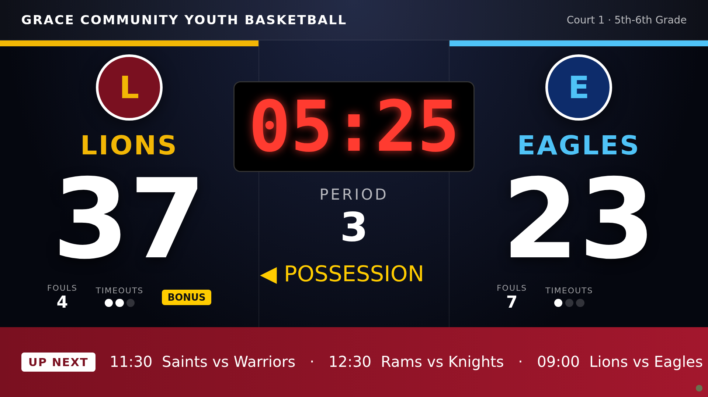
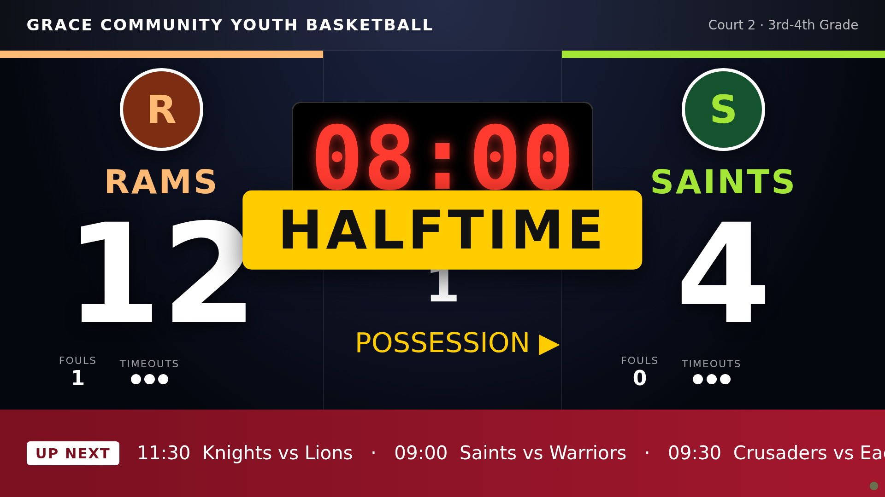

# UpwardScoreboard: Proof of Concept

Live youth-basketball scoreboard for the church league (Kansas City area). A bench scorekeeper taps big buttons on a phone or tablet, and the score, clock, fouls, timeouts and possession show instantly on the gym TV, with each matchup's team names, colors and logos. An optional transparent overlay feeds an OBS livestream.

Prepared by Devon (lead developer) with Sage (UI/UX), Avery (QA) and Morgan (PM) for Aaron. Date: October 16, 2026.

## 1. Summary

- Approach: custom build, fully cloud-hosted. There is no computer at the gym; it needs only a TV device with a browser and the scorekeeper's phone or tablet.
- Three modules: Score (bench controller), Display (TV board plus stream overlay), Admin (teams, courts, schedule).
- Stack: one TypeScript Node 20 container that serves the web pages, the API and live WebSocket updates, plus managed Postgres.
- Status: a working POC runs with docker compose. Unit tests (6/6) and an end-to-end smoke test (34/34) pass.
- Recommended host: Render, about $13 per month including managed Postgres.

Research mockups the POC follows:

## 2. Module features

Status key: Built = in the POC. Partial = partly built. Next = planned, not built.

### 2.1 Score: bench scorekeeper controller

URL: /score/court-1 (one link per court). Mobile-first with big buttons: one column on phones, and team, clock, team side by side on tablets.

| Feature | Status | Notes |
|---|---|---|
| Unlock with a court PIN | Built | The PIN is remembered on the device |
| Game clock start and stop | Built | One large toggle button |
| Clock adjust +1 s / -1 s and Set clock (mm:ss) | Built | Never below 0 or above the period length |
| Clock stops automatically at 0:00 | Built | Done on the server |
| Tenths of a second in the last minute | Built | |
| Period previous / next, with overtime | Built | Next period resets the clock. Fouls reset at halftime by default |
| Points +1, +2, +3 per team | Built | |
| Corrections (-1 point) | Built | Score never goes below 0 |
| Team fouls +/- and bonus indicator | Built | Bonus when the opponent reaches the foul limit (default 7) |
| Timeouts remaining | Built | Taking a timeout stops the clock |
| Possession arrow | Built | |
| Undo and redo history | Built | 100 steps. Undoing a basket does not rewind a running clock |
| Halftime banner, End game and save | Built | The final score is saved to the schedule |
| Status pills: online, TV connected, two scorekeepers | Built | |
| Taps during a short network drop are re-sent safely | Partial | Kept in memory only. The server ignores duplicates |
| Horn sound, player fouls, shot clock, offline app mode | Next | |

### 2.2 Display: TV scoreboard and streaming

URLs: /tv/court-1 (full-screen TV board) and /overlay/court-1 (transparent scorebug for OBS). Both are public and read-only.

TV layout: league name and court/division header. For each team: a color bar, logo or initial badge, name in the team color, a large score, fouls, timeout dots and a BONUS tag. In the center: a red clock, the period (OT1, OT2 for overtime) and the possession arrow. At the bottom: an UP NEXT ticker from the schedule. Also a HALFTIME/FINAL banner, and a waiting screen when no game is on the court.

| Behavior | Status | Notes |
|---|---|---|
| Live sync from the controller | Built | Pushed over WebSocket, about 50 ms in tests |
| Automatic reconnect | Built | Retries from 0.5 s up to 8 s. A small red dot blinks while offline |
| Exact state after reconnect or refresh | Built | The server sends the full current state on every connect |
| Clock accuracy | Built | Computed from server timestamps, so it does not drift |
| Resync when a TV stick wakes from sleep | Built | |
| Multiple courts at the same time | Built | Each court has its own TV, overlay and controller links |

Streaming options (the POC builds only the overlay page):

| Option | How it works | Pros | Cons |
|---|---|---|---|
| A. OBS browser-source overlay (page built) | A laptop runs OBS with a camera plus a Browser Source of /overlay/court-1 at 1920x1080 | Professional look, synced score, free, the laptop can also drive the TV | Needs a laptop and an OBS volunteer, and gym upload bandwidth |
| B. YouTube or Facebook Live through OBS | Option A plus a stream key | Families watch from home, and games are recorded | Channel live-stream eligibility, consent policy for minors, music copyright during warm-ups |
| C. Phone camera | Phone on a tripod streaming from the YouTube app, or an RTMP app that supports a web overlay | Cheapest, no laptop | Overlay support varies by app; battery, heat, uplink quality |
| D. Live score link only | Share the read-only TV link or a QR code | No video complexity | No video |

Recommendation: the pilot uses the TV only (the overlay is ready). Add option B once a volunteer owns OBS and the church approves a consent policy.

### 2.3 Admin

URL: /admin (admin password).

| Feature | Status | Notes |
|---|---|---|
| Today view: courts, live games, links, Start game on court | Built | The TV and controller switch to the new game instantly |
| Teams: name, short name, primary and accent colors, logo by URL or upload | Built | Uploads of 1 MB or less are stored in the database |
| Courts: add and delete, PIN status | Built | PINs come from server settings in the POC |
| Schedule: add and delete games, with court, time, division, home and away | Built | Times are in league time (America/Chicago) |
| Per-matchup overrides: display names and colors (alternate jerseys) | Built | |
| CSV import and export for courts, teams and schedule | Built | Google Sheets compatible. See section 9 |
| Change history for each game | Built (API) | Every change is logged with who made it |
| Direct Google Sheets sync | Next | Sheets API with a service account: pull the schedule, push results |
| Users and roles | Partial | Admin = password, scorekeeper = court PIN, public viewer = no login. Next: Google sign-in and per-day PINs |

## 3. Architecture and stack rationale

| Choice | Why |
|---|---|
| One Node 20 + TypeScript container | Serves the pages, the API and live updates from one process. A volunteer only has to keep one service and one database running |
| WebSockets in the same process | Two-way and low-latency. The controller sends commands and every screen receives updates over one connection. All recommended hosts support it |
| Plain HTML, CSS and JavaScript pages | No front-end build tooling to maintain. Sage can restyle with CSS files alone. The pages can move to React later without changing the server |
| Postgres for everything, including logos | One backup covers all data. No separate file storage |
| Two runtime libraries (ws, pg) | Little upgrade work over time |
| Docker | The same image runs on a laptop and on any managed host |

This deliberately differs from the research's heavier option (Turborepo, Express, Socket.IO, Prisma). Its main justification was a local court computer, which the cloud-only requirement removes.

UI files owned by Sage: public/tv.css, public/tv.html, public/overlay.css, public/overlay.html, public/score.css, public/score.html, public/admin.css, public/admin.html.

## 4. Data model

| Table | Purpose | Key columns |
|---|---|---|
| teams | League teams | name (unique), short_name, primary_color, secondary_color, logo_url, logo_data, logo_mime |
| courts | Physical courts | slug (unique, used in links and PINs), name, location, current_game_id |
| games | Scheduled and played games | court_id, home_team_id, away_team_id, scheduled_at, division, status, theme (matchup overrides), rules, history (live state plus undo), final_home, final_away |
| game_events | Change log for each game | game_id, seq, client_cmd_id, actor, command, created_at |

Planned later: seasons, divisions, users with roles, and hashed per-day court PINs.

## 5. Realtime approach

| Topic | Approach |
|---|---|
| Source of truth | The server. Controllers send intents (for example "home +2"), never "set score to 42" |
| Applying changes | Each game has one queue. The server validates each command, applies it with a tested reducer, saves it, then broadcasts the new state to everyone on that court |
| Ordering | Every change increases a sequence number (seq), and every change is logged in game_events |
| Clock | Stored as running, remaining time and a server start time. Each screen calculates the time from server time (offset measured by ping), so nothing drifts |
| Reconnect | Every connect or reconnect receives the full current state, so a TV or controller always shows exactly what the server has |
| Retries | Each tap has a unique id. Re-sent taps are recognized and applied only once |
| Two controllers on one game | Commands are queued in arrival order, and both taps count because commands are relative. Screens show a "2 scorekeepers" warning. A controller looking at an old game is refused and refreshed |
| Undo and redo | Full snapshots, kept in the database, so they survive a restart |
| Scale | One app instance easily serves a league. Running several instances would need extra coordination later |

## 6. Auth

| Role | POC | Next step |
|---|---|---|
| Admin | Password from server settings. Signed session cookie for 12 hours | Google sign-in with a users table |
| Scorekeeper | PIN for each court, valid only for that court | Per-day PINs or QR codes generated in Admin; limit wrong attempts |
| Public viewer | TV and overlay need no login; the server rejects any command from them | Optional public live-scores page |

HTTPS is provided by the host. Secrets live only in host settings, never in the code repository.

## 7. Hosting, deploy and costs

All options run the same Docker image plus managed Postgres. Deploys run automatically on each push, or with one command. Prices were checked on October 16, 2026 using the pricing pages below. Usage-based items are estimates.

| Host | App | Database | Estimated total per month | Notes |
|---|---|---|---|---|
| Render (recommended) | Web service, 512 MB: $7 | Managed Postgres, 256 MB, 1 GB storage: $6 | About $13 | Easiest dashboard. Database includes 3-day point-in-time recovery. 5 GB bandwidth included, then $0.15/GB. The free web tier sleeps when idle (not verified on the page) |
| DigitalOcean App Platform | Container, 512 MiB: $5 | Development database: $7 | About $12 (about $20 with a full managed database, estimate) | The development database has no backups by default |
| Fly.io | Machine, 512 MB: $3.69 | Managed Postgres Basic: $38 | About $42 | Good command-line tooling, but the database is expensive. No free tier |

Sources:

- Render pricing: https://render.com/pricing (checked 2026-10-16)
- DigitalOcean App Platform pricing: https://www.digitalocean.com/pricing/app-platform (checked 2026-10-16)
- Fly.io pricing: https://fly.io/docs/about/pricing/ (checked 2026-10-16)

Deploy steps on Render (planned, not yet done):

1. Create a Render Postgres database.
2. Create a Web Service from the code repository using the Dockerfile.
3. Set the settings: DATABASE_URL, ADMIN_PASSWORD, SESSION_SECRET, COURT_PINS, TZ=America/Chicago, SEED=false.
4. Set the health check path to /api/health.

Upkeep: nothing weekly. Each season, rebuild for security updates, change the PINs and export the CSVs as a backup.

## 8. Project plan

| Phase | Goal | Milestones | Owners |
|---|---|---|---|
| 0. POC (done) | Prove live sync, multiple courts, reconnect and clock accuracy | Game logic and tests, server, four pages, CSV, Docker, smoke test, screenshots, diagrams | Devon (build), Sage (restyle), Avery (test plan), Morgan (demo to Aaron) |
| 1. Pilot: one Saturday, one court | A real game with a real volunteer | Host chosen and deployed; final TV and phone look plus a one-page cheat sheet; dry run on gym Wi-Fi and the real TV device; free Keepthescore board as fallback; feedback collected | Devon (deploy), Sage (UI and cheat sheet), Avery (dry run), Morgan (volunteers and feedback) |
| 2. Season rollout | All courts, every Saturday | Season schedule imported from Google Sheets; per-day PINs or QR codes; Google sign-in for admins; results and standings; backups verified | Devon (backend), Sage (admin and standings UI), Avery (regression testing), Morgan (training and communication) |
| 3. Streaming | Families can watch | Overlay polish, YouTube channel, consent policy, trained OBS volunteer, phone-camera trial | Sage, Morgan, Avery, Devon (support) |

Next steps:

1. Aaron answers the open decisions below (Morgan).
2. Sage restyles the TV, controller and admin pages (CSS only).
3. Avery runs the test plan on the real TV device and gym Wi-Fi.
4. Devon deploys to the chosen host and loads the season schedule from the templates.
5. Morgan schedules the pilot Saturday and recruits a scorekeeper and a backup.

What Avery should test:

1. Two courts at once: nothing ever crosses courts.
2. TV loses Wi-Fi or power for 30 seconds: on reconnect, the score and clock match the controller (compare with a stopwatch).
3. Scorekeeper page refreshed mid-game: nothing is lost.
4. Two phones scoring one game: every tap counts exactly once.
5. Airplane mode for 5 seconds while tapping: each tap is applied once.
6. Undo and redo across score, fouls and the clock.
7. Clock edge cases: auto-stop, tenths, period change, timeout.
8. Bonus at the foul limit, and the reset at halftime.
9. Admin: logo upload, color overrides, starting a game.
10. CSV round trip through Google Sheets, with Kansas City times.
11. The TV cannot score; wrong or other-court PINs are rejected.
12. Real devices: TV stick sleep, iPhone, Android, OBS transparency.
13. About 50 viewers on one court.

Open decisions for Aaron:

1. Host: Render (about $13/month, recommended), DigitalOcean (about $12 to $20) or Fly.io (about $42)? Who owns the account and card?
2. Streaming: TV only for the pilot, then OBS to YouTube? Is a consent policy for minors needed first?
3. Courts: how many run at once, and which TV device for each? Is gym Wi-Fi reliable, or do we need a hotspot?
4. Scorekeepers: a parent volunteer for each game, or a trained crew?
5. League rules: quarters or halves, period length, timeouts, the foul limit for the bonus, when fouls reset, overtime length. POC defaults: 4 x 8 minutes, 3 timeouts, bonus at 7, reset at halftime.

## 9. Google Sheets import and export templates

Files in sheets-templates/. They match the POC importer exactly. Import them in Admin under Import / Export in this order: courts, then teams, then schedule.

| File | Columns | Import behavior |
|---|---|---|
| courts.csv | slug, name, location | Updates the court with the same slug, or adds it. Scorekeeper PINs are set separately (COURT_PINS) |
| teams.csv | name, short_name, primary_color, secondary_color, logo_url | Updates the team with the same name, or adds it. Colors must be #RRGGBB |
| schedule.csv | date, time, court, division, home, away | Adds games. date is YYYY-MM-DD, time is HH:MM in league time (America/Chicago), court is the court slug, home and away must match team names. Unknown courts are created; rows with unknown teams are rejected and reported |

Exports use the same columns. The schedule export adds home_score, away_score and status, which the importer ignores. In Google Sheets, use File > Download > CSV to produce a file for import, and File > Import > Upload to open an export.

## 10. Known risks and gaps

| Risk or gap | Impact | Mitigation |
|---|---|---|
| Gym Wi-Fi (captive portal, weak signal) | The TV or controller can't reach the cloud | Test before the pilot; bring a hotspot or travel router; Keepthescore as fallback |
| Taps during long outages are kept only in memory | Taps can be lost if the page is closed while offline | Offline app mode with stored queue (next step) |
| POC-level auth (PINs in server settings, no attempt limit) | Weak against a determined person | Per-day PINs, attempt limits, Google sign-in for admins |
| Single app instance | Restart takes a few seconds (state is preserved) | Fine for a league; coordination layer before scaling out |
| No database migration tool yet | Riskier schema changes later | Add a migration tool before the first post-launch change |
| Direct Google Sheets sync not built | Manual CSV steps | Sheets API sync in phase 2 |
| Streaming not built beyond the overlay | No family stream yet | Phase 3, after the consent policy |
| Missing features: horn, player fouls, shot clock; matchup logo override is API-only | Possible volunteer requests | Collect pilot feedback and prioritize |
| Volunteer turnover | Knowledge loss | One-page cheat sheet, managed host, minimal upkeep |
