# UpwardScoreboard: Proof of Concept

Live youth-basketball scoreboard for the Lenexa Baptist Church Upward league (Kansas City area). A bench scorekeeper taps big buttons on a phone or tablet, and the score, clock, fouls, timeouts and possession show instantly on the gym TV, with the grade, team names, logos and optional cheer squads, in the season's two-tone Maroon and Gold. An optional transparent overlay feeds an OBS livestream.

Prepared by Devon (lead developer) with Sage (UI/UX), Avery (QA) and Morgan (PM) for Aaron. Date: October 16, 2026.

## 1. Summary

- Approach: custom build, fully cloud-hosted. There is no computer at the gym; it needs only a TV device with a browser and the scorekeeper's phone or tablet.
- Three modules: Score (bench controller), Display (TV board plus stream overlay), Admin (teams, courts, schedule).
- Stack: one TypeScript Node 20 container that serves the web pages, the API and live WebSocket updates, plus managed Postgres.
- Status: a working POC runs with docker compose. After QA round 4 fixes, on a freshly rebuilt container: unit tests 18/18, browser offline test 11/11 (14/14 with the optional server-freeze check, E2E_PAUSE_CMD), browser lockout test 8/8, browser flow test 19/19, and the end-to-end smoke test 144/144 run twice in a row on the same used database.
- Courts: Full (whole floor), West and East (half courts). Full cannot run at the same time as West or East; West and East can run together. See section 3.4.
- Recommended host: Render, about $13 per month including managed Postgres.

Research mockups the POC follows:

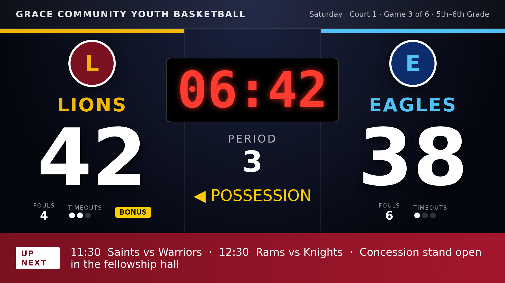

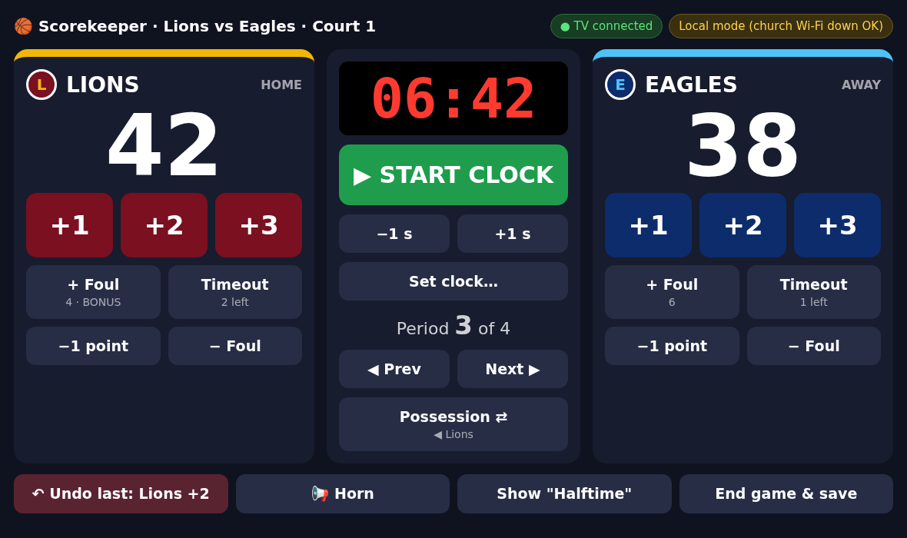

## 2. Setup and run (development)

Development defaults only. Never reuse these values on a hosted server.

1. Install Docker with the compose plugin.
2. In the project folder, copy .env.example to .env (dev values: admin password change-me-admin, court PINs full = 1111, west = 2222, east = 3333, GAME_MINUTES = 60, TZ = America/Chicago).
3. Run: docker compose up --build
4. Open http://localhost:3000 and pick a court. Admin is at http://localhost:3000/admin.
5. Open /upwardbasketballscores/westcourt on the TV and /score/west on the scorekeeper's phone (PIN 2222, or scan the court QR from Admin > Courts). Pick a game from today's list and confirm. Admin > Today can also start a game.

Tests: npm test (unit), node scripts/offline-e2e.mjs (browser offline test), node scripts/lockout-e2e.mjs (browser test: wrong PINs on East do not affect West), node scripts/flow-e2e.mjs (browser test: QR sign-in, picker, complete, resume, TV switching), node scripts/screenshots.mjs (retakes the screenshots; run on a fresh seed), node scripts/smoke.mjs (end to end; repeatable on a used database because it creates its own uniquely named teams and games; if a previous run left the admin login locked it waits out the lock, up to about a minute), node scripts/latency.mjs (sync time).

## 3. Module features

Status key: Built = in the POC. Partial = partly built. Next = planned, not built.

### 3.1 Score: bench scorekeeper controller

URLs: /score/full, /score/west, /score/east (one link per court; the weekly court QR opens the same page signed in). Mobile-first with big buttons: one column on phones, and team, clock, team side by side on tablets.

| Feature | Status | Notes |
|---|---|---|
| Unlock with the weekly court QR | Built | See section 3.4. The PIN stays as the fallback |
| Pick today's game, confirm, resume, Complete game | Built | See section 3.4 |
| Unlock with a court PIN | Built | A correct PIN gives the device a 12-hour session for that court only. Reconnects and reloads use the session with no PIN prompt. After too many wrong PINs a countdown shows until the next try |
| Taps while disconnected | Built | Kept on the device (even if the page is closed) and sent automatically after reconnect, exactly once. Closing the page with unsent taps asks for confirmation |
| Game clock start and stop | Built | One large toggle button |
| Clock adjust +1 s / -1 s and Set clock (mm:ss) | Built | Never below 0 or above the period length |
| Clock stops automatically at 0:00 | Built | Done on the server |
| Tenths of a second in the last minute | Built | |
| Period previous / next, with overtime | Built | Next period resets the clock. Fouls reset at halftime by default |
| Points +1, +2, +3 per team | Built | |
| Corrections (-1 point) | Built | Score never goes below 0 |
| Team fouls +/- and bonus indicator | Built | Bonus when the opponent reaches the foul limit (default 7) |
| Timeouts remaining | Built | Taking a timeout stops the clock |
| Possession arrow | Built | |
| Undo and redo history | Built | 100 steps. Undoing a basket does not rewind a running clock |
| Halftime banner, Complete game | Built | Asks for confirmation, saves the final score and locks the game (no more taps, no undo). Only Admin can reopen it |
| Status pills: online, TV connected, two scorekeepers | Built | "Online" means a fresh server message arrived within the last 3 seconds. The app pings every second; after 3 s of silence it shows "Offline · reconnecting…". Turning off Wi-Fi shows Offline immediately. Presence counts drop within about 4–6 s of a device vanishing |
| Taps during a short network drop are re-sent safely | Partial | Kept in memory only and re-sent after reconnect and re-auth. The server ignores duplicates |
| Horn sound, player fouls, shot clock, offline app mode | Next | |

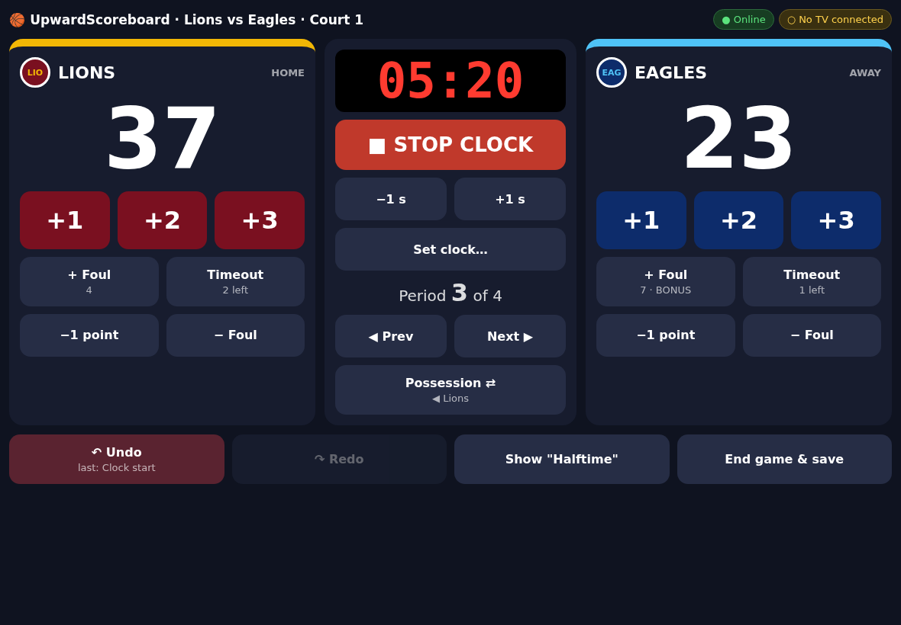

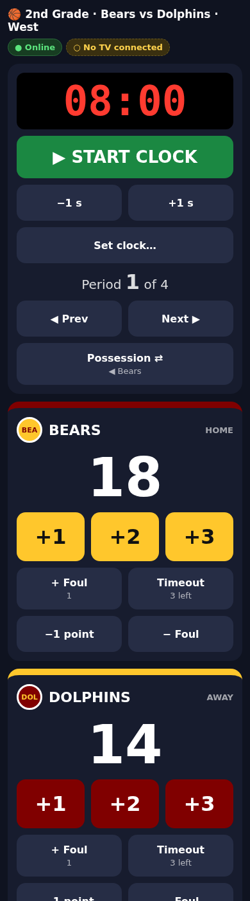

### 3.2 Display: TV scoreboard and streaming

URLs: /upwardbasketballscores/fullcourt, /upwardbasketballscores/westcourt and /upwardbasketballscores/eastcourt (full-screen TV board), the same with /overlay on the end (transparent scorebug for OBS), and /tv/split (West and East side by side on one TV). The older /tv/west and /overlay/west style links still work. All are public and read-only. Each link stays on the court all day: it shows an idle "Next up" screen between games and switches to the next game by itself.

TV layout: church logo (CHURCH_LOGO_URL) and name, league name and a court · grade · matchup header (for example "West · 5th Grade · Eagles vs Lions"). For each team: a color bar in the team's season color, logo or initial badge, name, optional cheer squad name and logo, a large score, fouls, timeout dots and a BONUS tag. In the center: a red clock, the period (OT1, OT2 for overtime) and the possession arrow. At the bottom: an UP NEXT ticker from the schedule (games on a later day show the date, for example "Sat Oct 24 · 10:00"). Also a HALFTIME/FINAL banner, and a waiting screen when no game is on the court.

| Behavior | Status | Notes |
|---|---|---|
| Live sync from the controller | Built | Measured tap-to-TV time over 100 taps (same machine, scripts/latency.mjs): median 6.3 ms, 95th percentile 9.4 ms, max 19.4 ms. Over the internet, add the network round trip |
| Automatic reconnect | Built | Detects silent drops with a 1 s app ping and a 3 s watchdog, plus the browser's offline/online events. Retries from 0.5 s up to 8 s. A small red dot blinks while offline |
| Clock while disconnected | Built | Freezes at the moment the connection is lost and is dimmed. It never keeps counting down. After reconnect it jumps to the server's value. In a silent drop (no offline event) it can run up to about 3 s before freezing |
| Readable colors (contrast) | Built (Sage) | Two season colors only (Maroon #800000, Gold #FFC72C). Text on them is picked automatically; ratios are in section 3.4. Admin checks the two season colors when they are changed |
| Overlay team names | Built | The OBS overlay shows the team short name (3–4 letters, set in Admin) and the grade. Cheer squads are not shown on the overlay (no room in the scorebug) |
| Exact state after reconnect or refresh | Built | The server sends the full current state on every connect |
| Clock accuracy | Built | Computed from server timestamps, so it does not drift |
| Resync when a TV stick wakes from sleep | Built | |
| Multiple courts at the same time | Built | Each court has its own TV, overlay and controller links |

Streaming options (the POC builds only the overlay page):

| Option | How it works | Pros | Cons |
|---|---|---|---|
| A. OBS browser-source overlay (page built) | A laptop runs OBS with a camera plus a Browser Source of /upwardbasketballscores/westcourt/overlay at 1920x1080 | Professional look, synced score, free, the laptop can also drive the TV | Needs a laptop and an OBS volunteer, and gym upload bandwidth |
| B. YouTube or Facebook Live through OBS | Option A plus a stream key | Families watch from home, and games are recorded | Channel live-stream eligibility, consent policy for minors, music copyright during warm-ups |
| C. Phone camera | Phone on a tripod streaming from the YouTube app, or an RTMP app that supports a web overlay | Cheapest, no laptop | Overlay support varies by app; battery, heat, uplink quality |
| D. Live score link only | Share the read-only TV link or a QR code | No video complexity | No video |

Recommendation: the pilot uses the TV only (the overlay is ready). Add option B once a volunteer owns OBS and the church approves a consent policy.

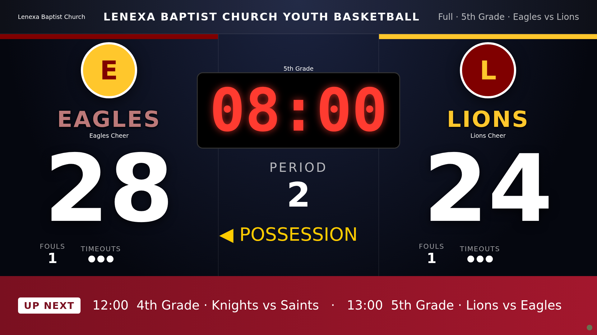

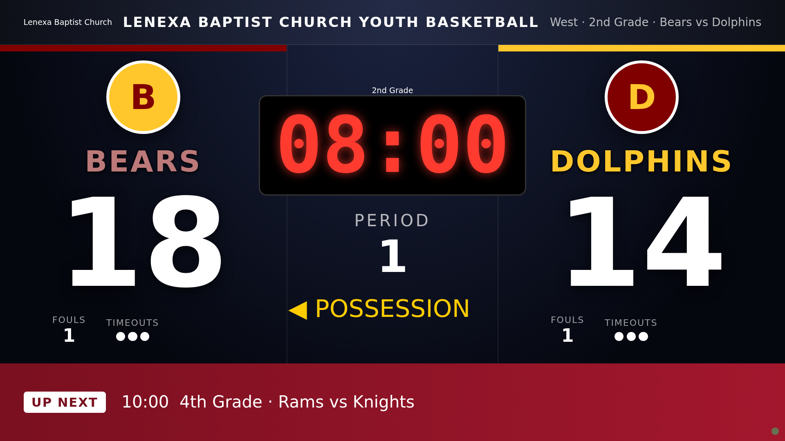

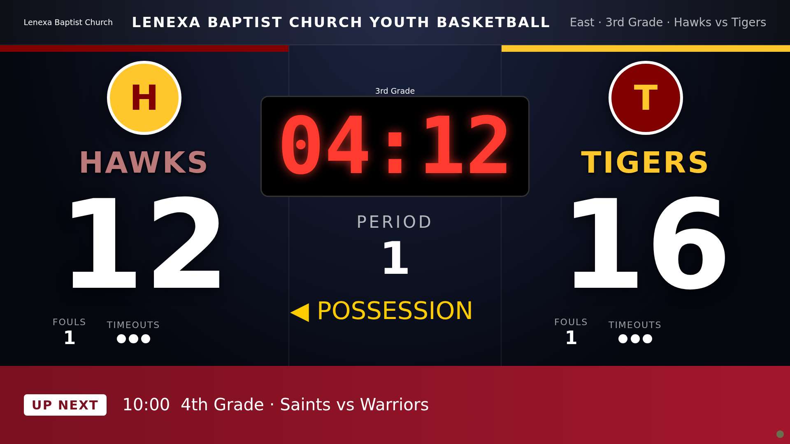

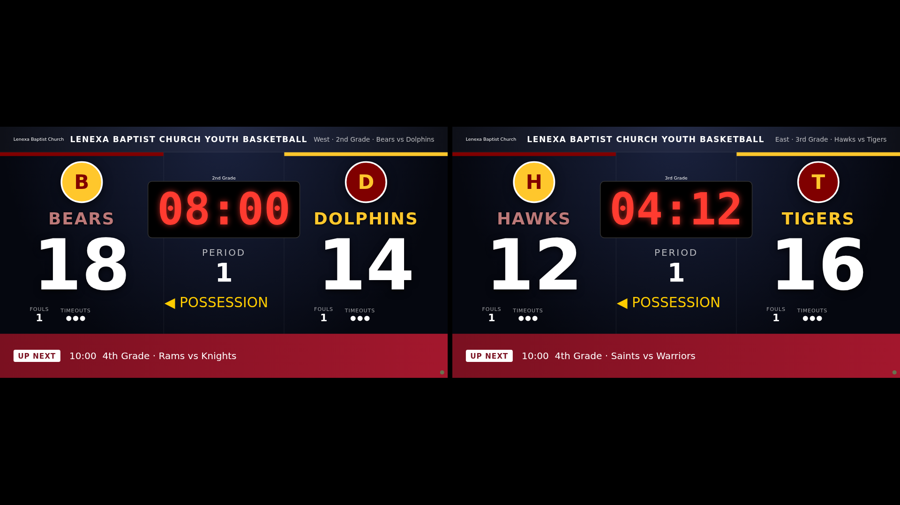

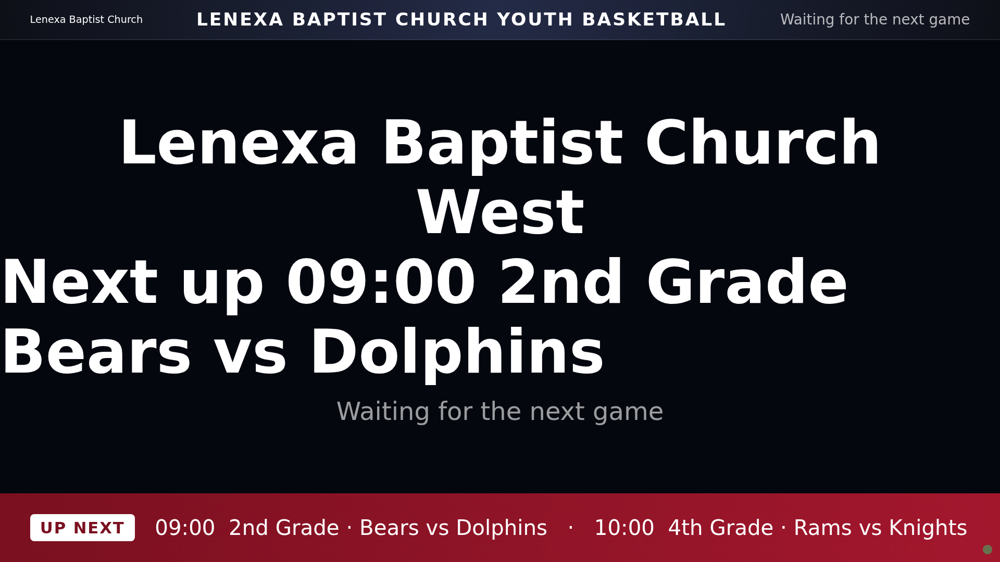

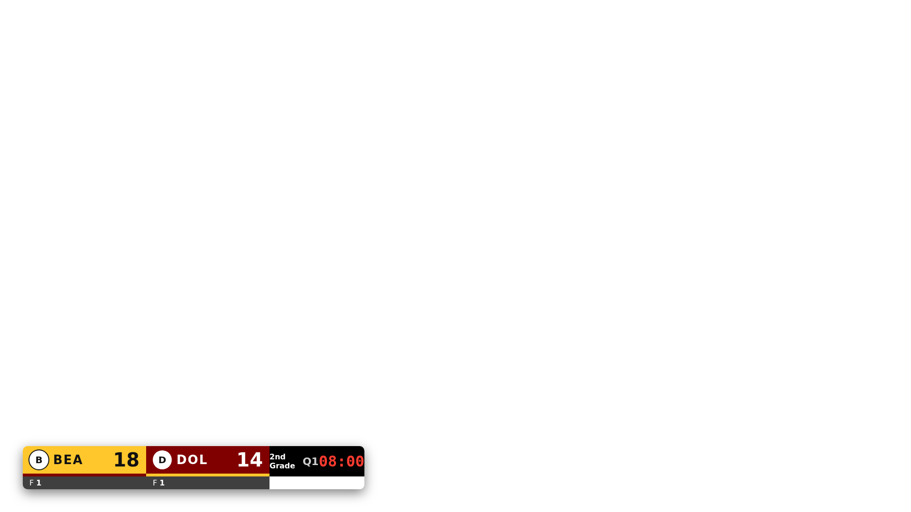

### 3.3 Admin

URL: /admin (admin password).

| Feature | Status | Notes |
|---|---|---|
| Today view: courts, live games, links, Start game on court | Built | The TV and controller switch to the new game instantly |
| Season: name and the two colors (dark and light) | Built | 2026–27 Upward: Maroon #800000 (dark) and Gold #FFC72C (light). Home wears light and away wears dark; a per-game Swap colors switch flips it |
| Teams: name, short name, grade, logo by URL or upload | Built | Lists sort by grade, then name, with a grade filter. Team colors are no longer used (the season colors are); per-matchup color overrides are under "Advanced". Uploads must be real PNG, JPEG, GIF or WebP files of 1 MB or less (checked by file content); SVG is refused. Larger files get a clear "limit is 1 MB" message. Logo URLs must start with http:// or https:// |
| Delete a team | Built | Refused with a friendly message if the team still has games |
| Courts: add and delete, PIN status, shared-floor rule, links, weekly QR print sheet | Built | PINs come from server settings in the POC. QR codes can be regenerated or revoked per court |
| Schedule: add, edit and delete games, with court, time, length, grade, division, home, away, swap colors and cheer squads | Built | Times are in league time (America/Chicago). A game must be within one grade. Shared-floor overlaps are refused with the conflicting game named (section 3.4) |
| Game status: Start, Complete, Reopen | Built | Status badges show scheduled, active or complete. Start is refused when Full and a half court would overlap, with a "Start anyway?" override |
| Per-matchup overrides: display names and colors (alternate jerseys) | Built | |
| CSV import and export for courts, teams and schedule | Built | Google Sheets compatible and safe to re-import: nothing is duplicated. Reports created, updated and skipped counts. See section 10 |
| Change history for each game | Built (API) | Every change is logged with who made it |
| Direct Google Sheets sync | Next | Sheets API with a service account: pull the schedule, push results |
| Users and roles | Partial | Admin = password, scorekeeper = court PIN, public viewer = no login. Next: Google sign-in and per-day PINs |

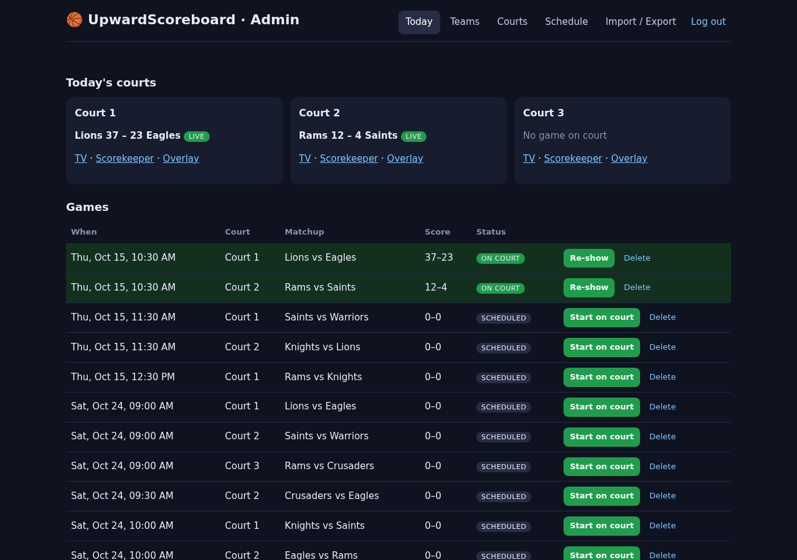

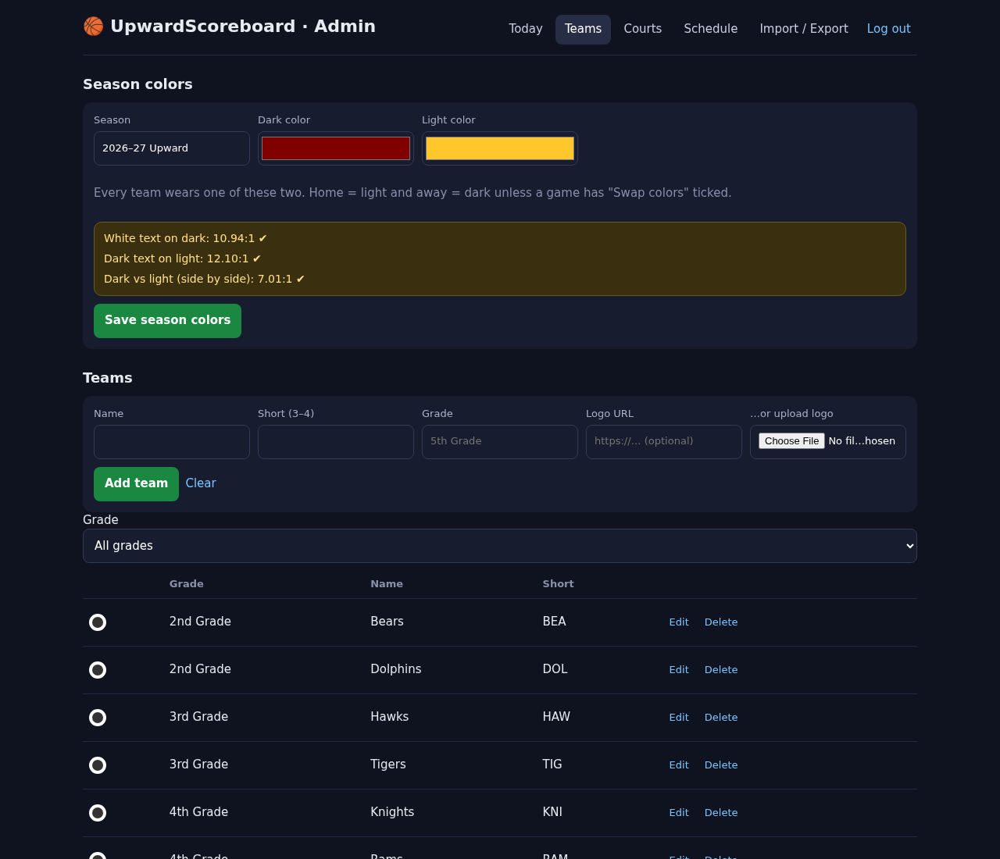

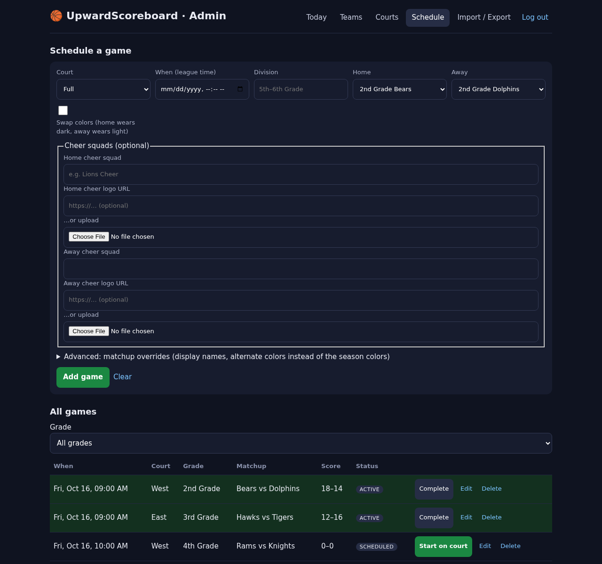

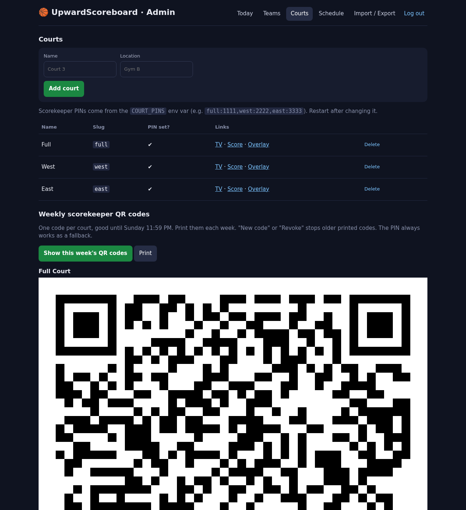

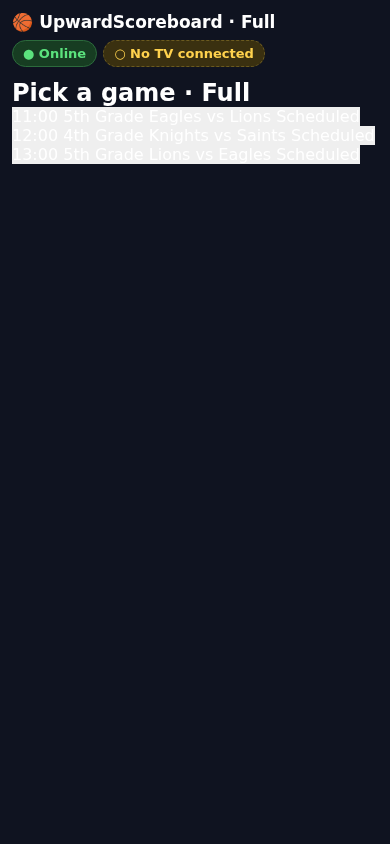

### 3.4 Courts, shared floor, season look and the scorekeeping flow (this batch)

Gym layout. The gym has one floor that is used two ways. Full is the whole floor (older grades). West and East are the two half courts across the floor (younger grades). West and East can run at the same time; Full cannot run at the same time as either of them.

| Court | Slug | Dev PIN | TV link | Overlay link | Scorekeeper link |
|---|---|---|---|---|---|
| Full | full | 1111 | /upwardbasketballscores/fullcourt | /upwardbasketballscores/fullcourt/overlay | /score/full |
| West | west | 2222 | /upwardbasketballscores/westcourt | /upwardbasketballscores/westcourt/overlay | /score/west |
| East | east | 3333 | /upwardbasketballscores/eastcourt | /upwardbasketballscores/eastcourt/overlay | /score/east |

Also: /tv/split (and /upwardbasketballscores/split) shows West and East side by side on one TV. The older /tv/full, /tv/west, /overlay/west style links still work. PINs are development values only.

Peak devices on site:

| Time block | Scorekeeper devices | TVs |
|---|---|---|
| West and East together | 2 (one per half court) | 2, or 1 TV showing /tv/split |
| Full | 1 | 1 (any TV can open the Full link) |

So the peak is 2 controllers plus 2 TVs (or 2 controllers plus 1 TV with the split view). A good setup is two TVs that show the West and East links during half-court blocks, with one of them switched to the Full link during Full blocks.

Shared-floor rule. Each game lasts from its start time for its length: GAME_MINUTES (default 60) unless the game has its own length (minutes column in the schedule CSV, or Length in Admin). Lengths touch but do not overlap, so 9:00 West and 10:00 Full are fine. The rule is general: each court lists the courts it shares the floor with (conflicts_with; Full lists West and East, and it works both ways).

| Where | What happens on a conflict |
|---|---|
| Schedule CSV import | That row is an error naming the conflicting game (for example "overlaps game #12 on full (Eagles vs Lions, 11:00-12:00); west and full share the floor"); other rows still import |
| Admin add or edit game | Refused with the conflicting game named (HTTP 409) |
| Starting a game (Admin or scorekeeper picker) | Refused while a game on a conflicting court is active, for example "Full is live". Admin gets a "Start anyway?" override |

Season look. Teams no longer have their own colors. The season has two colors: 2026–27 Upward, dark Maroon #800000 and light Gold #FFC72C (Admin > Teams > Season). Home wears light (Gold) and away wears dark (Maroon); a Swap colors switch per game (Admin or the swap_colors CSV column) flips it. The advanced matchup overrides in Admin still exist for special cases.

Contrast of the season colors (WCAG ratio, 4.5:1 is the minimum for text):

| Pair | Ratio |
|---|---|
| White text on Maroon | 10.95:1 |
| Near-black #111 text on Gold | 12.10:1 |
| Black text on Gold | 13.46:1 |
| Maroon next to Gold | 7.02:1 |
| Gold on the dark TV background #1b2340 | 9.89:1 |
| Maroon on the dark TV background | 1.41:1 (too low; the TV lightens it automatically for text and rings) |

Church and cheer squads. The TV shows the church logo (CHURCH_LOGO_URL setting) and name (Lenexa Baptist Church). Each game can have one optional cheer squad (one per game, not per side; changed 2026-10), with a name and a logo (URL or upload, same checks as team logos). It shows as one line on the TV (center column) and on the schedule screen, not on the overlay, and never on the scorekeeper page.

Grades. Each team has a grade (seeded: 2nd, 3rd, 4th and 5th Grade). A game must be within one grade; mixed-grade games are refused in CSV import and in Admin. Each team also has a gender (Boys or Girls), and a game must be within one grade and one gender. The grade and gender show on the TV, overlay, schedule and scorekeeper, for example "3rd Grade Girls · Eagles vs Lions" (home team first).

Scorekeeping flow (Aaron's Saturday):

1. Each week Admin prints the court QR sheet (Admin > Courts > Print QR codes): one signed code per court, valid until Sunday 23:59 Kansas City time. Regenerate or Revoke on a court makes its old codes stop working at once and signs out every phone that signed in with an old code (they see "This phone was signed in with a court QR code that has been replaced…" and can scan the new code or use the PIN). Phones signed in with the PIN stay signed in.
2. The volunteer scans the court's QR. It opens /score/west, signs the device in for 12 hours and removes the code from the address bar. The court PIN still works as the fallback. A bad, expired or revoked code shows a clear message and counts toward the device lockout, like a wrong PIN.
3. The phone lists today's games on that court that are not complete. Tapping one asks "Load 5th Grade Eagles vs Lions on West Court?". Confirming makes it the court's active game. Only one game can be active per court (enforced by the database), and the shared-floor rule applies.
4. The TV and overlay links switch to the active game automatically, and back to the idle "Next up" screen (with the last final score) when it is completed.
5. When the game ends, "Complete game" asks for confirmation, saves the final score and locks the game: no more taps and no undo. Admin can force-complete or reopen a game.
6. A device that reloads or rejoins while its game is still active is offered "Resume".
7. The schedule export includes status and final scores; the status import can mark paper-scored games complete.

lbc.org/upwardbasketballscores options (nothing has been changed in DNS; this is for Aaron to decide with whoever runs lbc.org):

| Option | How | Pros | Cons |
|---|---|---|---|
| A. Subdomain (CNAME) | scores.lbc.org points at the host with a CNAME record; the host issues HTTPS. Links become scores.lbc.org/upwardbasketballscores/westcourt | Simple, one DNS record, WebSockets work, independent of the church website | Not exactly lbc.org/upwardbasketballscores; needs DNS access |
| B. Reverse proxy path | The church website's server forwards lbc.org/upwardbasketballscores/... to the app | The exact address on the main site | Depends on the website host allowing proxying and WebSocket upgrades (many site builders do not); the app's other paths (/score, /api, /ws) must be forwarded too; the most moving parts |
| C. Redirect | lbc.org/upwardbasketballscores redirects to the app's own address (host URL or option A) | Easiest; most site builders support redirects | The address bar shows the other address after the redirect; the QR codes and bookmarks then use the app address |

Recommendation: A, with C on the main site for a friendly link. Set PUBLIC_BASE_URL to the final address so the printed QR codes use it.

Migration. No wipe is needed. On start the server renames an existing court-1 to west and court-2 to east (keeping their games), adds full with its floor rule, maps old statuses (live to active, final to complete; if a court had more than one live game, the extra ones are completed), and adds the new columns with defaults. This was tested on a copy of a database from the previous version and is safe to run repeatedly. Update COURT_PINS to full, west and east. For a clean demo with today's sample games, reset the dev database with docker compose down -v.

Test counts (after the QA round 4 fixes, freshly rebuilt container): unit 18/18; browser offline 11/11 (14/14 with the optional server-freeze check); browser lockout 8/8; browser flow 19/19 (QR sign-in, picker, complete lock, resume, TV switching, sign-out on Regenerate, QR lockout wording, idle cleanup); smoke 144/144 (including team names per grade, cheer logo export, QR session invalidation, the shared-IP spare phone case and the round 4 CSV fixes), run twice in a row on the same used database (covers floor overlap in CSV and Admin, grades, season colors, cheer squads, QR tokens, one active game per court, complete locking and the status export and import).

Markup added for Sage (functional only, unstyled where noted): church logo and name on the TV and overlay; cheer squad slots on the TV; grade spans on the TV, overlay and scorekeeper; idle screen #idle with #next-up and .last-final (unstyled); scorekeeper #picker with .pick items and .status-badge, #resume prompt, dialog#confirm-dialog and #complete-game; Admin #season-form with the .contrast-warn box, #swap-colors, #cheer-fields, grade filters, status badges, Start/Complete/Reopen buttons and the QR print panel #qr-panel (print-friendly .qr-card, .no-print buttons); public/split.html with split.css (Sage owns it).

What Avery should test in this batch:

1. Start West and East together; then try to start Full: refused ("Full is live"), and Admin's "Start anyway?" works.
2. Import a schedule CSV where a Full game overlaps a West game: that row is an error naming the game. Try a 45-minute game using the minutes column.
3. Mixed-grade game in CSV and in Admin: refused.
4. Scan a printed QR on a phone: signed in, the code disappears from the address bar. Regenerate in Admin: the old printout fails with a clear message, and a phone already signed in with it is signed out. Several bad codes trigger the lockout countdown with QR wording ("Too many invalid QR codes…"), and other phones on the same Wi-Fi keep working.
5. Picker, confirm, score, Complete game: the score locks and the TV goes to Next up. Reload mid-game: Resume is offered. Admin Reopen works.
6. Swap colors on one game; cheer squads with and without logos on the TV; the overlay shows no cheer squads; the scorekeeper never does.
7. Export the schedule, mark a never-started game complete with scores, re-import.
8. /tv/split on the real TV from across the gym.

### 3.5 Lobby schedule screen, gender, warnings and the demo weekend (2026-10)

**Screens and routes**

| Screen | Address | Notes |
|---|---|---|
| Scorekeeper | /score/{full,west,east} | PIN or weekly QR; picker lists today's games on the court, else the court's next game day within a week (with the day shown) |
| TV | /upwardbasketballscores/{full,west,east}court (also /tv/<court>) | Home team on the left, always |
| Overlay (OBS) | /upwardbasketballscores/<court>court/overlay | Transparent 1920x1080 |
| West + East on one TV | /upwardbasketballscores/split (also /tv/split) | West left, East right; each half home-left |
| **Schedule (lobby TV)** | **/upwardbasketballscores/schedule**, alias **/schedule** | All courts, one day; ?day=fri, ?day=sat (demo weekend) or ?date=YYYY-MM-DD; default today (America/Chicago) |
| Admin | /admin | Password |

**Schedule screen features.** A 1920x1080 lobby TV, live over the same WebSocket as the TV (role=schedule, subscribed to every court): any score, clock, status (load, complete, reopen) or schedule change (Admin edit, import, delete, season colors) pushes a fresh snapshot within ~150 ms. Header: "LBC Upward", the church name and the day ("Saturday, Oct 17"). Two columns, West Court and East Court, for the split block, one slot per hour; Full Court games are rows spanning both columns in time order (on Saturday after the split block, at 16:30). States: complete shows ✓ FINAL with the final score (winner marked); active is highlighted with ● LIVE, the live score, period and running clock (server time, frozen while offline); upcoming shows the time, both teams in season colors (home Gold/light, away Maroon/dark, swapped per game when Swap colors is on; order never changes), the grade + gender label ("3rd Grade Girls"), the cheer squad if set, and 🕒 UP NEXT on each court's next game. **Paging rule (2026-10):** live and upcoming games always come first and finals are the lowest priority. Live games and each court's UP NEXT sit in a pinned band above the frame that never moves (a Full Court game is "next" only when no West/East game is scheduled before it, and vice versa). Below it, the later upcoming games, then the most recent finals as compact one-line rows in whatever room is left; older finals collapse into "▲ N earlier finals". If the upcoming games alone overflow, only that part pages (every 12 s, breaking between rows), and the finals use the room left on its last page, so they never add a page. With no overflow there is one page and no dots. Root `data-phase` is early (nothing final yet), midday or end (nothing upcoming). The motion is a CSS transition that is off under prefers-reduced-motion. Offline/reconnect is the same as the TV (data-conn on the root, connecting/offline/online).

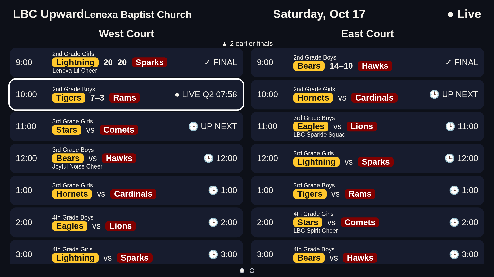

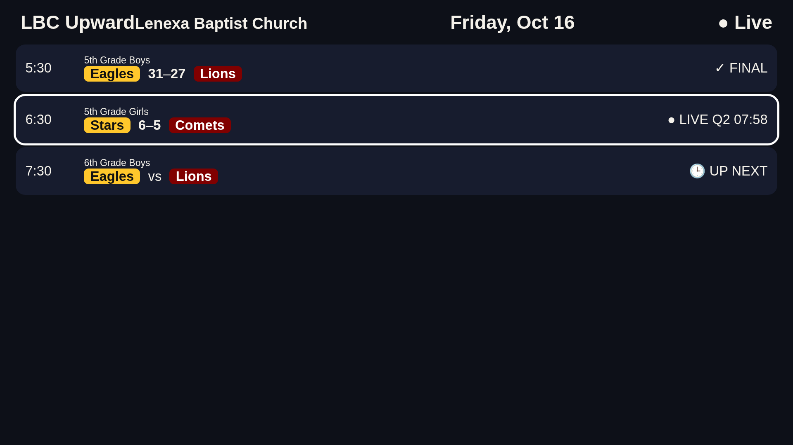

Paging scenes (browser e2e, 1920x1080, scripts/schedule-paging-e2e.mjs):

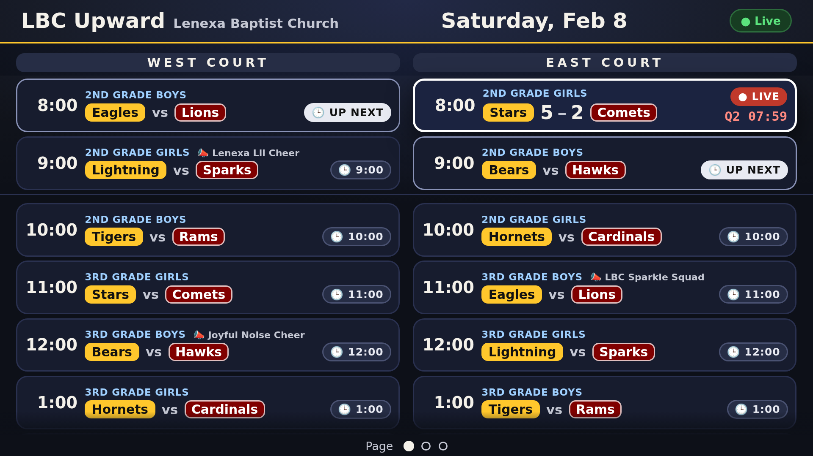
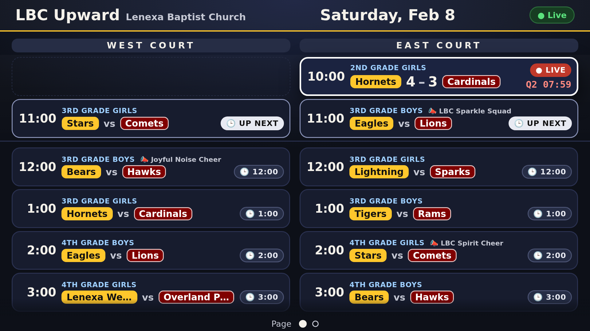
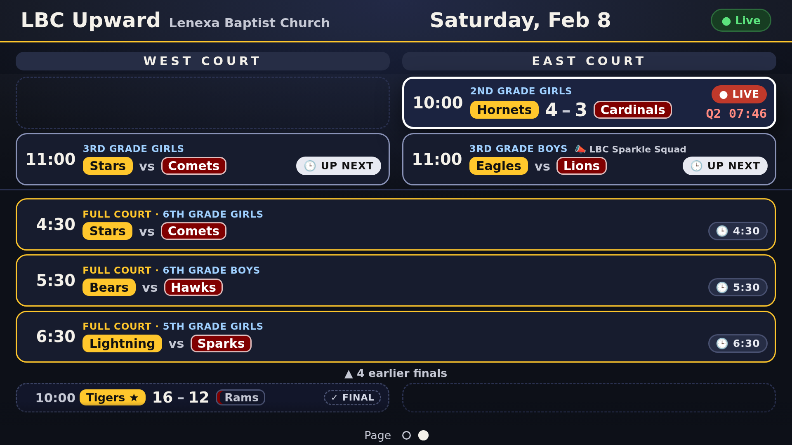
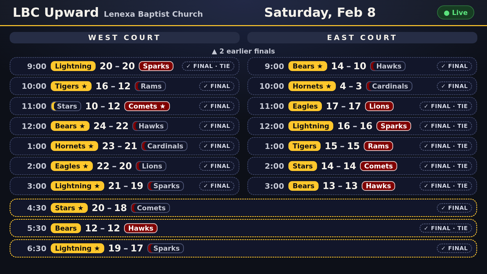

**Gender.** Teams have a gender (Boys/Girls) in Admin (Teams), teams.csv and schedule.csv. Team names are unique per grade + gender + name (migration: the new unique index is a superset of the old grade + name one, created first, then the old one is dropped, so existing data always fits). A game must be within one grade and one gender (Admin and import refuse mixed games). The label "3rd Grade Girls" is shown on the TV header, the overlay, the scorekeeper header, picker and dialogs, Admin and the schedule.

**Home team first.** Everywhere a matchup or score is shown, the home team is listed first ("Eagles vs Lions" = Eagles at home) and is on the left of side-by-side boards; Swap colors changes colors only. Audit (2026-10): TV, overlay, split, scorekeeper (header, picker, load/complete dialogs), Admin tables, CSV exports (home before away, home_score before away_score), the ticker and the new schedule all already list home first; nothing needed flipping. Sage pinned home-left in the TV and overlay CSS (dff4e1d). A unit test checks the markup order and the text templates; smoke checks the export header and the schedule order (also after a swap).

**Warnings (not errors)** in Admin (Schedule: a warning list and a ⚠ tag per game; saving a game shows its warnings) and in CSV import results: a team playing twice in one Fri–Sat weekend; a cheer squad on a game that isn't 2nd–4th grade, or isn't a Saturday split-court game (West/East, 08:00–16:00); a West/East game that starts before 08:00 or ends after 16:00. GET /api/warnings lists them all.

**Demo weekend seed** (SEED=demo, seed-demo.js, Start-Demo.ps1 -Reseed; the sheets-templates example schedule is generated from the same plan by scripts/gen-templates.mjs). Season 2026–27 Upward, Maroon/Gold, Lenexa Baptist Church. The weekend is chosen relative to today in America/Chicago: today + tomorrow on a Friday, yesterday + today on a Saturday, otherwise the upcoming Friday and Saturday (for Fri Oct 16, 2026 that is Oct 16–17).

- Friday: Full Court 17:30, 18:30, 19:30. Saturday: West + East hourly 08:00–15:00 (last game ends 16:00), 16 games; then Full Court 16:30, 17:30, 18:30. All Full Court games are 5th–6th grade.
- Every team plays exactly once (2 new teams per game, 44 teams); all games stay scheduled.
- Boys/Girls split evenly: each Saturday hour has one Boys and one Girls game (West Boys / East Girls at 08, 10, 12, 14; swapped at 09, 11, 13, 15), so 8 + 8; Full Court 3 Boys + 3 Girls across 5th and 6th grade.
- Cheer squads (one per game) on four Saturday split games, all 2nd–4th grade: 09:00 West, 11:00 East, 12:00 West, 14:00 East.

**Uneven split decision.** 16 split games over three grades can't divide evenly (16/3). Youngest first, the 2nd and 3rd graders get 3 hours each (6 games: 08–10 and 11–13) and the 4th graders get 2 hours (4 games: 14–15). Reason: keep whole hours per grade so both courts always run the same grade (simpler gym flow and parents of one grade arrive together), give the younger grades (bigger Upward turnout, earlier bedtimes) the larger share, and let the 4th graders, who are closest in age to the 5th–6th Full Court block, play last right before it.

| Slot | West | East |
|---|---|---|
| Fri 17:30 | Full: 5th Grade Boys · Eagles vs Lions | |
| Fri 18:30 | Full: 5th Grade Girls · Stars vs Comets | |
| Fri 19:30 | Full: 6th Grade Boys · Eagles vs Lions | |
| Sat 08:00 | 2nd Grade Boys · Eagles vs Lions | 2nd Grade Girls · Stars vs Comets |
| Sat 09:00 | 2nd Grade Girls · Lightning vs Sparks · cheer Lenexa Lil Cheer | 2nd Grade Boys · Bears vs Hawks |
| Sat 10:00 | 2nd Grade Boys · Tigers vs Rams | 2nd Grade Girls · Hornets vs Cardinals |
| Sat 11:00 | 3rd Grade Girls · Stars vs Comets | 3rd Grade Boys · Eagles vs Lions · cheer LBC Sparkle Squad |
| Sat 12:00 | 3rd Grade Boys · Bears vs Hawks · cheer Joyful Noise Cheer | 3rd Grade Girls · Lightning vs Sparks |
| Sat 13:00 | 3rd Grade Girls · Hornets vs Cardinals | 3rd Grade Boys · Tigers vs Rams |
| Sat 14:00 | 4th Grade Boys · Eagles vs Lions | 4th Grade Girls · Stars vs Comets · cheer LBC Spirit Cheer |
| Sat 15:00 | 4th Grade Girls · Lightning vs Sparks | 4th Grade Boys · Bears vs Hawks |
| Sat 16:30 | Full: 6th Grade Girls · Stars vs Comets | |
| Sat 17:30 | Full: 6th Grade Boys · Bears vs Hawks | |
| Sat 18:30 | Full: 5th Grade Girls · Lightning vs Sparks | |

(Team names repeat across divisions on purpose, like a real league: 2nd Grade Boys Eagles and 3rd Grade Boys Eagles are different teams.)

**Tests (2026-10, freshly rebuilt container):** unit 23/23 (gender, demo weekend, seed invariants, warnings, home-first markup/templates); smoke 169/169 run twice on the same used database (gender, warnings incl. legacy two-cheer CSV, schedule routes, snapshot, live updates on swap/start/score/complete, read-only, home first); browser flow 19/19, lockout 8/8, offline 11/11; latency median 8.7 ms, p95 10.7 ms. The cheer migration was verified on the box's old data (3 games moved, 2 with both sides set kept home and were logged).

**Tests (paging rule, 2026-10-16):** unit 30/30 (adds phase, pinned selection, ordering, aligned blocks, finals collapse, page breaks); schedule paging browser e2e 28/28 at 1920x1080 (early, mid-day incl. page 2, end: live + next in .sched-pinned, fully visible, unmoved across a page turn, no empty pinned slots, order, compact finals inside the last page, ≥1 compact final mid-day, dots only on overflow); smoke 173/173 twice; flow 19/19, lockout 8/8, offline 11/11.

**Hooks for Sage** (functional markup only; schedule.css is a minimal placeholder for Sage to replace). Structure matches docs/mockups/schedule-structure.md: root `data-conn` (connecting|online|offline), `data-day` (fri|sat|…), `data-date`, `data-page` (0-based), `data-pages`, `--offset` (and `--page`) in px, class `overflows`, `has-active`; `.sched-track` also gets `--offset` + `data-page`; `.heads` hidden when the day has no split games; `.sched-pinned` (live + UP NEXT, outside `.sched-view`, never translated; only real games, no `data-empty` slots; each court's column top-aligned), `.sched-track` = later upcoming then finals (only it pages; `data-offsets` lists the page tops in px), `.game[data-compact=true]` on finals shown in the leftover space, `.earlier` (inside the track, just above the shown finals) text "▲ N earlier finals" (empty when none), root `data-phase` (early|midday|end; absent with no games); `.foot` gets one `<i>` per page (`.on` = current), empty with one page. Per game: `.court-col[data-court=west|east] > .slot[data-time]` (empty slot keeps rows aligned: `data-empty`), `.full-row > .slot > .game[data-span=full]`, `.game[data-state=complete|active|upcoming]`, `[data-winner=home|away|tie]` on complete, `[data-next=true]` on each court's next game, `[data-swapped]`, `[data-court]`, `[data-game-id]`, class `has-cheer`; chips `.chip.home` / `.chip.away` with `data-wear=light|dark` and `--team-color` / `--team-accent` (colors only); `.score` for active/complete, `.score.vs` for upcoming; `.pc` (period + clock) only on active; `.cheer` (img `cheer-logo` + `cheer-name`) only with a squad. data-binds: time, grade-label, home-name, away-name, home-score, away-score, cheer, cheer-logo, period, clock, status-tag, brand, church-name, day, connText, earlier. TV: one `.cheer` in `section.center` after `.poss` (binds cheer / cheer-logo, root `has-cheer`); per-side cheer binds retired. Admin: new Gender select (Teams form), Gender column, `#schedule-warnings` box, `.warn-tag` and `tr.has-warning` in game rows, single cheer fieldset (unstyled additions).

## 4. Architecture and stack rationale

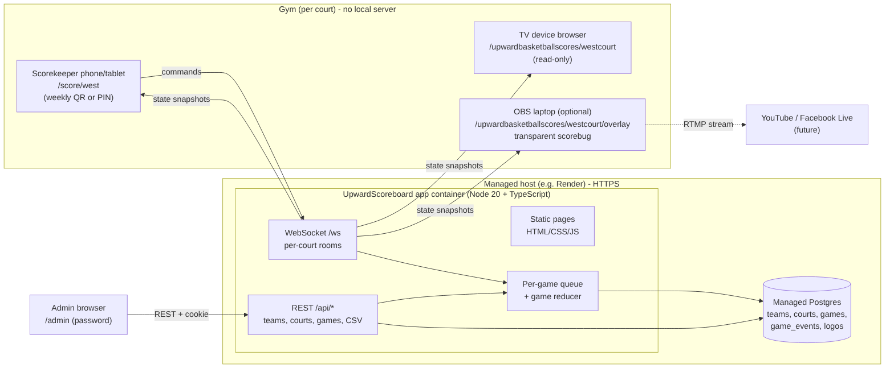

| Choice | Why |
|---|---|
| One Node 20 + TypeScript container | Serves the pages, the API and live updates from one process. A volunteer only has to keep one service and one database running |
| WebSockets in the same process | Two-way and low-latency. The controller sends commands and every screen receives updates over one connection. All recommended hosts support it |
| Plain HTML, CSS and JavaScript pages | No front-end build tooling to maintain. Sage can restyle with CSS files alone. The pages can move to React later without changing the server |
| Postgres for everything, including logos | One backup covers all data. No separate file storage |
| Two runtime libraries (ws, pg) | Little upgrade work over time |
| Docker | The same image runs on a laptop and on any managed host |

This deliberately differs from the research's heavier option (Turborepo, Express, Socket.IO, Prisma). Its main justification was a local court computer, which the cloud-only requirement removes.

UI files owned by Sage: public/tv.css, public/tv.html, public/overlay.css, public/overlay.html, public/score.css, public/score.html, public/admin.css, public/admin.html, public/split.css, public/split.html.

## 5. Data model

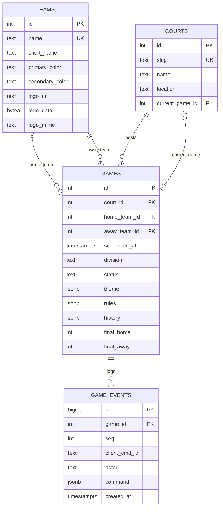

| Table | Purpose | Key columns |
|---|---|---|
| teams | League teams | name (unique per grade + gender, ignoring case), short_name, grade, grade_order, gender (Boys, Girls or empty), logo_url, logo_data, logo_mime (primary_color and secondary_color are kept but unused) |
| courts | Physical courts | slug (unique, used in links and PINs), name, location, conflicts_with (courts sharing the floor), qr_version, current_game_id |
| games | Scheduled and played games | court_id, home_team_id, away_team_id, scheduled_at, division, status (scheduled, active, complete; at most one active game per court), duration_min, swap_colors, cheer (one squad per game: cheer, cheer_logo_url or an uploaded logo), theme (advanced matchup overrides), rules, history (live state plus undo), final_home, final_away |
| game_events | Change log for each game | game_id, seq, client_cmd_id, actor, command, created_at |
| settings | League settings | season_name, season_dark, season_light |

Planned later: seasons, divisions, users with roles, and hashed per-day court PINs.

## 6. Realtime approach

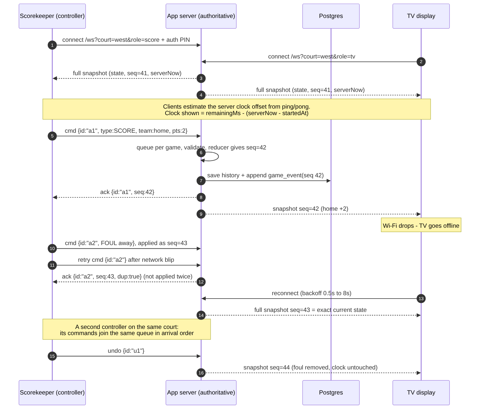

| Topic | Approach |
|---|---|
| Source of truth | The server. Controllers send intents (for example "home +2"), never "set score to 42" |
| Applying changes | Each game has one queue. The server validates each command, applies it with a tested reducer, saves it, then broadcasts the new state to everyone on that court |
| Ordering | Every change increases a sequence number (seq), and every change is logged in game_events |
| Clock | Stored as running, remaining time and a server start time. Each screen calculates the time from server time (offset measured by ping), so nothing drifts |
| Reconnect | Every connect or reconnect receives the full current state, so a TV or controller always shows exactly what the server has |
| Heartbeat | Server pings every 2 s and drops a connection after about 3.5 s of silence, so presence stays accurate. Browsers send an app-level ping every second and treat 3 s of silence as offline. While offline, clocks freeze and dim |
| Retries | Each tap has a unique id. Re-sent taps are recognized and applied only once |
| Two controllers on one game | Commands are queued in arrival order, and both taps count because commands are relative. Screens show a "2 scorekeepers" warning. A controller looking at an old game is refused and refreshed |
| Undo and redo | Full snapshots, kept in the database, so they survive a restart |
| Scale | One app instance easily serves a league. Running several instances would need extra coordination later |

## 7. Auth

| Role | POC | Next step |
|---|---|---|
| Admin | Password from server settings. Signed session cookie for 12 hours. 5 wrong passwords lock that address for 30 s (doubling, max 15 min) with HTTP 429 and Retry-After | Google sign-in with a users table |
| Scorekeeper | PIN for each court, valid only for that court. A correct PIN gives that device a signed 12-hour session for that court, stored on the device; reconnects use it and are never affected by lockouts. The weekly court QR gives the same session (section 3.4), tied to the court's QR version: Regenerate or Revoke ends QR sessions, PIN sessions stay. Wrong PINs and bad QR codes are counted per court and per device: 5 lock that device for that court for 30 s (doubling, max 15 min) with an on-screen countdown (with QR wording for bad codes), and close the connection. A backstop of 100 wrong PINs from one network address (gym phones share one) blocks further PIN tries from that address; bad QR codes never count toward it, and valid sessions and valid QR codes are never blocked by it. TV and overlay links are read-only, and their connections never count toward a lockout | Per-day PINs; per-person logins |
| Public viewer | TV and overlay need no login; the server rejects any command from them | Optional public live-scores page |

HTTPS is provided by the host. Secrets live only in host settings, never in the code repository.

## 8. Hosting, deploy and costs

All options run the same Docker image plus managed Postgres. Deploys run automatically on each push, or with one command. Prices were checked on October 16, 2026 using the pricing pages below. Usage-based items are estimates.

| Host | App | Database | Estimated total per month | Notes |
|---|---|---|---|---|
| Render (recommended) | Web service, 512 MB: $7 | Managed Postgres, 256 MB, 1 GB storage: $6 | About $13 | Easiest dashboard. Database includes 3-day point-in-time recovery. 5 GB bandwidth included, then $0.15/GB. The free web tier sleeps when idle (not verified on the page) |
| DigitalOcean App Platform | Container, 512 MiB: $5 | Development database: $7 | About $12 (about $20 with a full managed database, estimate) | The development database has no backups by default |
| Fly.io | Machine, 512 MB: $3.69 | Managed Postgres Basic: $38 | About $42 | Good command-line tooling, but the database is expensive. No free tier |

Sources:

- Render pricing: https://render.com/pricing (checked 2026-10-16)
- DigitalOcean App Platform pricing: https://www.digitalocean.com/pricing/app-platform (checked 2026-10-16)
- Fly.io pricing: https://fly.io/docs/about/pricing/ (checked 2026-10-16)

Deploy steps on Render (planned, not yet done):

1. Create a Render Postgres database.
2. Create a Web Service from the code repository using the Dockerfile.
3. Set the settings: DATABASE_URL, ADMIN_PASSWORD, SESSION_SECRET, COURT_PINS, PUBLIC_BASE_URL (used in the QR codes), LEAGUE_NAME, CHURCH_NAME, CHURCH_LOGO_URL, GAME_MINUTES, TZ=America/Chicago, SEED=false.
4. Set the health check path to /api/health.

Upkeep: print the court QR sheet each week (Admin > Courts > Print QR codes). Each season, rebuild for security updates, change the PINs and export the CSVs as a backup.

## 9. Project plan

| Phase | Goal | Milestones | Owners |
|---|---|---|---|
| 0. POC (done) | Prove live sync, multiple courts, reconnect and clock accuracy | Game logic and tests, server, four pages, CSV, Docker, smoke test, screenshots, diagrams | Devon (build), Sage (restyle), Avery (test plan), Morgan (demo to Aaron) |
| 1. Pilot: one Saturday, one court | A real game with a real volunteer | Host chosen and deployed; final TV and phone look plus a one-page cheat sheet; dry run on gym Wi-Fi and the real TV device; free Keepthescore board as fallback; feedback collected | Devon (deploy), Sage (UI and cheat sheet), Avery (dry run), Morgan (volunteers and feedback) |
| 2. Season rollout | All courts, every Saturday | Season schedule imported from Google Sheets; per-day PINs or QR codes; Google sign-in for admins; results and standings; backups verified | Devon (backend), Sage (admin and standings UI), Avery (regression testing), Morgan (training and communication) |
| 3. Streaming | Families can watch | Overlay polish, YouTube channel, consent policy, trained OBS volunteer, phone-camera trial | Sage, Morgan, Avery, Devon (support) |

Next steps:

1. Aaron answers the open decisions below (Morgan).
2. Sage restyles the TV, controller and admin pages (CSS only).
3. Avery runs the test plan on the real TV device and gym Wi-Fi.
4. Devon deploys to the chosen host and loads the season schedule from the templates.
5. Morgan schedules the pilot Saturday and recruits a scorekeeper and a backup.

What Avery should test:

1. West and East at once: nothing ever crosses courts. Full cannot start while West or East is active (and the reverse), unless Admin forces it.
1a. The new batch: see the list at the end of section 3.4.
2. TV loses Wi-Fi or power for 30 seconds: on reconnect, the score and clock match the controller (compare with a stopwatch).
3. Scorekeeper page refreshed mid-game: nothing is lost.
4. Two phones scoring one game: every tap counts exactly once.
5. Airplane mode for 5 seconds while tapping: each tap is applied once.
6. Undo and redo across score, fouls and the clock.
7. Clock edge cases: auto-stop, tenths, period change, timeout.
8. Bonus at the foul limit, and the reset at halftime.
9. Admin: logo upload, color overrides, starting a game.
10. CSV round trip through Google Sheets, with Kansas City times.
11. The TV cannot score; wrong or other-court PINs are rejected.
12. Real devices: TV stick sleep, iPhone, Android, OBS transparency.
13. About 50 viewers on one court.

Open decisions for Aaron:

1. Host: Render (about $13/month, recommended), DigitalOcean (about $12 to $20) or Fly.io (about $42)? Who owns the account and card?
2. Streaming: TV only for the pilot, then OBS to YouTube? Is a consent policy for minors needed first?
3. Courts: confirm the Full / West / East layout, which TV device for each, and whether lbc.org/upwardbasketballscores should be a subdomain, a proxy path or a redirect (section 3.4)? Is gym Wi-Fi reliable, or do we need a hotspot?
4. Scorekeepers: a parent volunteer for each game, or a trained crew?
5. League rules: quarters or halves, period length, timeouts, the foul limit for the bonus, when fouls reset, overtime length. POC defaults: 4 x 8 minutes, 3 timeouts, bonus at 7, reset at halftime.

## 10. Google Sheets import and export templates

Files in sheets-templates/. They match the POC importer exactly. Import them in Admin under Import / Export in this order: courts, then teams, then schedule.

| File | Columns | Import behavior |
|---|---|---|
| courts.csv | slug, name, location, conflicts_with (required: slug, name) | Matched by slug: adds new courts, updates changed ones, skips identical ones. slug must be lowercase letters, digits and dashes. conflicts_with lists the courts sharing the floor, separated by spaces or semicolons (full has "west east"); it works both ways. Scorekeeper PINs are set separately (COURT_PINS) |
| teams.csv | name, short_name, grade, gender, logo_url (required: name) | gender is Boys or Girls (b/g accepted); with the column, teams match by grade + gender + name. Matched by grade + name, so 2nd Grade Eagles and 5th Grade Eagles are separate teams: adds, updates or skips. An old file without a grade column matches by name only, and a name that exists in two grades is a row error. A team with no grade yet is given the grade from the file. grade accepts 5, 5th or 5th Grade (K for Kindergarten). Old files with primary_color and secondary_color still import; those columns are ignored. logo_url must be http(s) or empty |
| schedule.csv | id, date, time, court, grade, gender, division, home, away, minutes, swap_colors, cheer, cheer_logo (required columns: date, time, court, home, away; all others optional, so old files still import) | Keep the id column when you edit an exported sheet: it is how a game whose time, court or teams changed is updated instead of added again. Leave id blank only for new games. If id is filled (from an export), that game is updated. Otherwise games are matched by court + start time + home + away, which the database enforces as unique. Duplicate rows in one file are skipped. date is YYYY-MM-DD, time is HH:MM in league time (America/Chicago), court must be an existing court slug (unknown courts are a row error, not created), home and away must be existing teams in the same grade. Teams are found by grade + name: with the grade column filled, that grade is used; without it, a team name that exists in only one grade is used, and a name that exists in several grades takes the other team's grade; if that still leaves a choice, the row is an error asking for the grade column. minutes overrides GAME_MINUTES for that game. swap_colors is yes/no. A row that overlaps a game on a shared-floor court is a row error naming that game. Cheer logos must be http(s) URLs. In exports, an uploaded cheer logo is written as the full address of the served file (for example https://host/logos/cheer/12). One cheer squad per game: older files with home_cheer/away_cheer still import (whichever is set; if both are set, home is kept and the row gets a warning). The gender column picks the right team when a name exists in both genders; a Boys vs Girls game is a row error. Rows that import may still get warnings: a team twice in one Fri–Sat weekend, a cheer squad on a game that isn't 2nd–4th grade or isn't a Saturday West/East game between 08:00 and 16:00, a West/East game outside 08:00–16:00; re-importing it keeps the upload unchanged. A game that is not scheduled yet can have date and time both empty (and court empty); exports write such games that way and they re-import cleanly |

A file missing a required column is rejected as a whole with a message naming the column. Every bad row is reported with its row number; good rows still import. Re-importing the same file, or an export, changes nothing (all rows reported as skipped).

Exports use the same columns. The schedule export starts with the game id (keep it) and adds home_score, away_score and status. Scores are the final score for completed games and the current score for active games. On import, status is optional: a game that never started can be set to complete with its scores (for paper-scored games); changing the status of a game that has already started is a row error. A row with only id and status (plus scores; the other cells blank or the columns left out) changes just the status. Clearing a cheer logo cell removes that game's uploaded logo; a cheer logo address that points to another game's uploaded logo (a copied row) is not carried over, and the row imports with a warning. A note on keeping the id column is also in sheets-templates/README.md. In Google Sheets, use File > Download > CSV to produce a file for import, and File > Import > Upload to open an export.

## 11. Known risks and gaps

| Risk or gap | Impact | Mitigation |
|---|---|---|
| Gym Wi-Fi (captive portal, weak signal) | The TV or controller can't reach the cloud | Test before the pilot; bring a hotspot or travel router; Keepthescore as fallback |
| Taps during long outages are kept only in memory | Taps can be lost if the page is closed while offline | Offline app mode with stored queue (next step) |
| POC-level auth (PINs in server settings, 4-digit PINs) | Guessing is now throttled, but PINs are shared and long-lived | Per-day PINs, Google sign-in for admins |
| PIN lockouts are per court and device, held in memory | Someone guessing on one court cannot lock out other courts or a scorekeeper already signed in (sessions skip the PIN). Lockouts reset when the server restarts, and a guesser who clears site data gets a new device id (5 more tries); the 100-per-address PIN backstop and 4-digit PINs limit this to slow guessing; bad QR codes lock only the device that sent them | Per-day PINs, per-person logins later |
| Scorekeeper sessions last 12 hours | Anyone holding an unlocked phone can score on that court for the day. Changing SESSION_SECRET signs everyone out | Per-day PINs; a sign-out button |
| Schedule times in the 1 a.m. hour on the night clocks fall back are ambiguous in league time | Two such games with the same court and teams could look like duplicates on re-import. Not realistic for youth games | Store the UTC offset in exports if ever needed |
| Single app instance | Restart takes a few seconds (state is preserved) | Fine for a league; coordination layer before scaling out |
| No database migration tool yet | Riskier schema changes later | Add a migration tool before the first post-launch change |
| Direct Google Sheets sync not built | Manual CSV steps | Sheets API sync in phase 2 |
| Streaming not built beyond the overlay | No family stream yet | Phase 3, after the consent policy |
| Shared floor relies on scheduled lengths | A game that runs long is not blocked; the next game on a conflicting court is refused at Start until it is completed (Admin can force) |
| Weekly QR codes are shared like PINs | A photo of the QR works until Sunday night | Revoke or regenerate in Admin; PIN lockout counts bad codes |
| Missing features: horn, player fouls, shot clock; matchup logo override is API-only | Possible volunteer requests | Collect pilot feedback and prioritize |
| Volunteer turnover | Knowledge loss | One-page cheat sheet, managed host, minimal upkeep |

## 12. Known bugs and backlog

From QA round 1 (Avery). Fixed in round 1: silent network drops (#1), duplicate schedule imports (#2), PIN and login guessing (#3), oversized logo dropping the connection (#4), contrast (#5, fixed by Sage), unclear CSV errors (#8), raw error when deleting a team (#9), logo file and URL validation (#10).

| Item | Status | Notes |
|---|---|---|
| QA #6: closing the controller with unsent taps lost them silently (the queue was only in memory, no warning) | Fixed (round 2) | Unsent taps are saved on the device and resent after reopening; closing the page with unsent taps asks for confirmation. A saved tap for a game that has since changed is discarded with a message |
| QA #7: Undo right after the clock reached 0 undid the earlier clock start with no visible change (the "End of period" step was not recognised as a clock step) | Fixed (round 2) | The automatic stop at 0 keeps the previous undo label, so Undo now undoes the last real action. Unit test added |
| QA #11: Prev after an accidental Next did not bring back the fouls reset at halftime, and reset the clock | Fixed (round 2) | Prev right after Next restores the period's fouls and clock. Unit test added |
| QA round 2 A and D: wrong PINs on one court locked out the whole gym, including a signed-in scorekeeper after a Wi-Fi blip | Fixed (round 2) | See section 7. Smoke and browser tests reproduce the exact scenario |
| QA round 2 B: an exported game with no date failed to re-import | Fixed (round 2) | Empty date and time (and court) are accepted |
| Colored logo images are not contrast-checked | Backlog | Only the team color pairs are checked |
| Grey team colors near #808080 are borderline | Backlog | They pass at about 4.78:1, just above the 4.5:1 minimum |
| Clock can run up to about 3 s before freezing in a silent drop | Known limit | Turning Wi-Fi off is detected immediately; a silent drop takes the 3 s watchdog |
| Phone controller shows the clock above the teams | Backlog (Sage) | Decide the layout order after the pilot |
| Horn, player fouls, shot clock; matchup logo override in the Admin form | Backlog | |
| Cheer squads on the overlay | Backlog | The scorebug has no room; shown on the TV only |
| QA round 4: Regenerate did not sign out phones already signed in with the old QR | Fixed (round 4) | QR sessions carry the QR version; see section 7 |
| QA round 4: QR lockout said "Too many wrong PINs" | Fixed (round 4) | "Too many invalid QR codes on this phone…"; the message box gets data-cause="qr" |
| QA round 4: blank cheer logo cell kept an uploaded logo; copied rows carried another game's logo address | Fixed (round 4) | See section 10 |
| QA round 4: id + status rows failed with "home team is empty" | Fixed (round 4) | Partial rows update only the status |
| QA round 4: Up next listed later-day games with the time only | Fixed (round 4) | Later days show the date, for example "Sat Oct 24 · 10:00" |
| QA round 4: leftover team color class on the idle TV | Fixed (round 4) | The idle screen clears every per-game class and color |
| Offline dimming on the idle, picker, resume and confirm screens | Fixed (Sage) | Every screen carries data-conn; dashed frame and "Reconnecting…" label |
| QA final F3: "TV connected" pill stayed green while the phone was offline | Fixed (JS) | Shows "TV status unknown (reconnecting)"; hooks html.presence-stale and .pill.tv[data-stale] for a grey style |
| QA final F4: scanning an old printed QR got the generic error style | Fixed (JS) | Now data-cause="revoked", same as a signed-out phone |
| QA final F1 and F2: TV offline label clips the Next up matchup (idle) and covers the grade chip (live, split) | Backlog (Sage, CSS) | Fix before the trial |
| QA final F5: Admin Today table scrolls sideways at 390 px | Backlog (Sage, CSS) | Admin is used on a laptop |
| Maroon text directly on the dark TV background is 1.41:1 | Handled (Sage) | contrast.js lightens it automatically; worth a look on the real TV |

## 13. On-site test checklist for Aaron

Do this at the gym about a week before the pilot, with the real TV devices and the scorekeepers' phones.

1. Connect the TV devices and the phones to the gym Wi-Fi. Note any sign-in page (captive portal); the TV device may not get past it.
2. Open /upwardbasketballscores/westcourt on one TV and /upwardbasketballscores/eastcourt on the other, full screen. Check that each is readable from the far bench and the stands, and that the screens do not sleep within 30 minutes. If there is only one TV, try /tv/split from the stands.
3. Print the weekly QR sheet from Admin > Courts. Scan the West code with a phone: it should sign in and show today's West games. Check that "Online" and "TV connected" show. Also try the PIN fallback once.
4. Pick a game and confirm. The West TV should switch from "Next up" to the game. Tap +2, a foul and a timeout: the TV should update immediately.
5. Start the clock and compare it with a phone stopwatch for 2 minutes. It should match within a second.
6. Turn a TV device's Wi-Fi off for 30 seconds while the clock runs, then on again. The TV clock should freeze and dim, then come back with the correct time and score.
7. Do the same with the phone. It should show "Offline · reconnecting…", then recover. Taps made just before or during the drop should count once. Reload the page: it should offer Resume.
8. Run West and East at once and confirm nothing crosses over. While they are active, try to load a Full game: it should be refused. On the East phone, scan an old or wrong code 5 times: it should show a countdown, and the West phone must keep working.
9. Complete the West game: the score locks and the TV shows "Next up" with the final score. Then load a Full game on a phone and switch a TV to the Full link.
10. Check that the Maroon and Gold colors, the church logo and cheer squads look right on the real TV.
11. Try a mobile hotspot as a backup network and repeat step 4.
12. Write down anything confusing for the volunteer and send it to Morgan.
